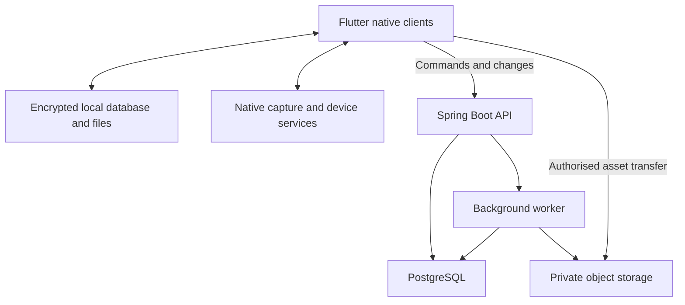

# Personal Finance Application Product Requirements

Version 1.0 | 19 October 2026 | Product and engineering specification

## 1 Product direction

Build a personal finance application that helps a person understand their money, plan spending, and keep receipts with very little ongoing administration. The product must work on iPhone, iPad, Android phones and tablets, Windows, macOS, and Linux. Phone workflows should favour quick capture; tablet and desktop workflows should support planning, reconciliation, and detailed review.

The recommended implementation is Flutter for the native clients, an encrypted local SQLite database, and optional cloud synchronisation through a Java and Spring Boot modular monolith backed by PostgreSQL and private object storage. A user must be able to start locally without registering, capture a receipt without internet access, and enable synchronisation later. These are proposed product decisions, subject to the decision register in section 18.

Australia is the proposed first market, with AUD, Australian date formats, fortnightly income, and the July to June financial year as defaults. Currency and locale must be explicit settings. The initial release supports one currency per finance workspace. International bank connectivity, tax filing, and investment trading are outside the initial scope.

### Reference product and differentiation

Dollarwise provides a useful reference for adjustable 50/30/20 budgeting, transaction categorisation, a short review routine, and explainable insights. Its website describes web, Android, and iOS access and says its bank connectivity is focused on the United States; Australia is not currently supported. [S1]

This product adopts the simple budgeting and review approach, with its own interface and branding. Its proposed distinguishing features are fast receipt capture, useful operation offline, native desktop applications, flexible pay cycles, and Australian localisation. Receipt functionality specified here is a new requirement, rather than a claim about Dollarwise.

### Outcomes and success measures

The primary outcome is a trustworthy view of spending that remains useful when transactions arrive from several sources. Accuracy takes precedence over automated categorisation volume.

| Measure | Initial target | Measurement method |
| --- | --- | --- |
| First useful budget | At least 80% of usability participants complete setup in 10 minutes | Moderated tasks with 10 to 15 representative participants |
| Receipt capture effort | Median under 20 seconds from opening capture to saving a readable image locally | Timed tasks on agreed reference phones; excludes optional review |
| Weekly review effort | Median under 5 minutes for 30 transactions | Timed review using seeded data |
| Receipt extraction | At least 95% exact totals and 90% exact dates on the agreed supported test corpus | Held out corpus, with results by capture source and platform |
| Financial correctness | No unexplained balance differences in release fixtures | Automated ledger and reconciliation checks |
| Stability | At least 99.8% crash free sessions in beta | Privacy filtered crash reporting with consent |

Targets are proposed release criteria, not measured performance claims. Real customer financial content must never be collected to calculate product metrics.

## 2 Users and primary journeys

### Intended users

The main user manages personal or family finances and wants a small number of clear answers: what was spent, what is committed, what remains in each budget, and which transactions need attention. A second user may prefer detailed reconciliation and use a tablet or desktop for imports and bulk edits. Shared household access is a subsequent release; the first release is one person using several devices.

### Journey A Start with existing finances

The user selects locale, base currency, and local or synced operation; creates bank, cash, and credit card accounts; enters opening balances and their dates; imports a CSV if available; and chooses a budget template. A guided preview explains transfers, card repayments, and expenses before accepting the import. A budget can be useful without a bank connection or an extensive account history.

### Journey B Capture a receipt at a shop

From the home screen or platform shortcut, the user opens the camera, captures one or more pages, and saves immediately. The app stores a readable copy before starting text extraction. It proposes merchant, date, total, and currency. The user can review now or leave the item in the receipt inbox. A receipt may be attached to an existing transaction or used to propose a new expense; attaching it must not create a second expense.

### Journey C Review the week

The user opens a queue of unreviewed transactions, corrects categories, matches receipts, resolves possible duplicates, and checks upcoming bills. Swipe actions are optional shortcuts. Every action also has a visible button and undo. Rules suggested from corrections apply only after confirmation and show their expected effect.

### Journey D Plan on a larger screen

The user views budget and actual amounts together, searches transaction history, opens a receipt beside its transaction, and imports bank statements using drag and drop. Keyboard navigation, multi selection, bulk categorisation, and a persistent detail pane reduce repetitive interaction.

### Journey E Continue after being offline

A receipt and an expense entered on a disconnected phone appear immediately on that phone. When connectivity returns, the app uploads changes and images separately, displays progress, and checks for conflicts. A concurrent edit on another device produces a reviewable conflict rather than silently replacing the first edit.

## 3 Release scope and priorities

P0 means required for the first general release. P1 means the next planned increment after the core proves reliable. P2 means an optional expansion requiring a separate scope decision. The first mobile beta may precede desktop beta, but completion of P0 includes supported desktop clients.

| Capability | P0 | P1 | P2 |
| --- | --- | --- | --- |
| Native clients | iOS and Android phones and tablets; Windows, macOS, Linux | Broader device certification | Browser application |
| Accounts and transactions | Manual accounts, CSV import, splits, transfers, refunds, reconciliation | OFX and QIF import | Additional regional formats |
| Budgeting | Category budgets, adjustable 50/30/20, rollover, weekly and fortnightly cycles | Advanced zero based allocation mode | Multiple independent budgeting methods |
| Bills and planning | Recurrence, calendar, reminders, 90 day cash forecast | Subscription detection and debt scenarios | Longer planning simulations |
| Goals and net worth | Savings goals; manual assets, loans, investments and super balances | Detailed holdings and debt payoff comparisons | Market feeds and retirement modelling |
| Receipts | Camera, image and PDF import, OCR, search, matching, manual splits | Item level extraction, warranty reminders, email forwarding | Direct merchant receipt integrations |
| Data and sync | Local operation, optional personal sync, backup, export and restore | Shared households; Australian bank feeds after provider selection | Wider country connectivity |
| Insights | Explainable rules and budget comparisons | Anomaly detection and optional cloud extraction | Conversational financial exploration |

P0 does not include payments, bank credential storage, stock trading, financial product recommendations, tax return preparation, or unrestricted mailbox access. No generative AI feature is a launch dependency. A public commercial release would additionally require a separate billing and subscription scope; personal or family use does not need a payment system.

## 4 Accounts and transaction requirements

### Account management

**FIN 01 Account types.** Support transaction accounts, savings, cash, credit cards, loans, and manually valued assets such as property, investments, and superannuation. Show liquid money, liabilities, and net worth separately. An opening balance records an effective date and adjusts opening equity; it is not income.

**FIN 02 Account controls.** Users can include or exclude an account from budgets, cash forecasts, and net worth independently. Archiving preserves history. Deleting an account with postings requires a deliberate resolution of those postings and cannot leave orphaned transactions. Show each account's data source and last reconciliation date.

**FIN 03 Transaction entry.** Create income, expense, transfer, refund, and balance adjustment entries with amount, account, effective date, merchant or payee, category, notes, tags, and optional receipts. Provide a calculator style amount input. Distinguish entry date from financial effective date.

**FIN 04 Splits.** A transaction may span multiple categories. Split amounts must equal the transaction total exactly before posting. A receipt can support several splits. Tags such as holiday, child, project, and reimbursable are independent of the category hierarchy.

**FIN 05 Transfers and cards.** Moving money between owned accounts is not income or expense. A credit card purchase counts as spending on the purchase effective date; paying the card reduces cash and card debt without counting the purchase again. Interest and fees remain expenses. Matching imported transfer legs must produce one linked economic transfer.

**FIN 06 Refunds and reimbursements.** A refund can link to the original purchase and reduce the original category on the refund's effective date. The default does not rewrite a previous period. A reimbursement can clear a receivable or offset an expense using an explicit user choice. Both sides remain traceable.

**FIN 07 Status and correction.** Keep draft, pending, posted, and reversed states distinct. Drafts do not affect actual balances. Pending authorisations affect the pending view and planned availability, not the posted ledger. Financial corrections create a reversal and replacement linked to the original; metadata changes retain revision history. Users see an ordinary edit workflow.

**FIN 08 Reconciliation.** Users enter a statement date and closing balance, mark included entries, and see the difference. Completion requires zero difference or an explicitly confirmed adjustment. Imported or reported balances are observations used for reconciliation; they must not silently replace calculated balances.

### Internal financial model

Use a balanced journal internally. A posting references a ledger account and a signed amount in minor currency units; each journal balances to zero within its currency. User accounts map to asset or liability accounts; categories map to income or expense accounts. Opening equity, transfer clearing, and reimbursement receivables are system accounts. Net worth includes assets less liabilities, rather than income and expense account balances.

The interface never requires accounting terminology. Do not store money as binary floating point. P0 stores amounts as signed 64 bit minor units with range validation and an explicit currency exponent. Percentage allocation uses exact arithmetic with a deterministic rounding remainder. Rate calculations use decimal arithmetic. Multi currency journals and foreign exchange valuation are deferred.

## 5 Budgets and savings goals

**BUD 01 Budget setup.** Provide adjustable Needs, Wants, and Savings allocations with categories beneath them. Offer a simpler category only setup using the same underlying budget model. A template is a starting point; the user can change percentages and category amounts. Show over allocation and unassigned money explicitly. Income is take home income; the app does not estimate tax or compulsory super contributions.

**BUD 02 Periods.** Support calendar months, weeks, fortnights, and custom anchored periods. Record start, end, timezone, and rollover policy. Fortnightly schedules advance by 14 days from an anchor; monthly schedules preserve the intended day with an explicit end of month rule. Never approximate a month as four weeks. Optional monthly equivalents use documented annual factors and remain labelled estimates.

**BUD 03 Budget arithmetic.** For each category, remaining budget equals planned allocation plus opening rollover plus approved adjustments minus posted net spending in the period. Show pending spending separately. Rollover policy is none, positive only, or signed. Historical plans retain their versions; changing a future allocation does not rewrite previous budgets.

**BUD 04 Savings allocation.** Savings goals have a target, target date, optional linked account, and planned contributions. Moving money to savings is still a transfer in the ledger. A separate allocation record counts it toward the Savings plan without creating an expense. The app must distinguish allocated savings from money actually moved.

**BUD 05 Sinking funds.** A category or goal can reserve money for irregular expenses such as insurance or holidays. Show amount reserved, target, and funding gap. A dollar must not be reserved simultaneously for several goals unless the app clearly marks an unfunded allocation.

**BUD 06 Debt presentation.** Loans show principal, interest and fees separately. Principal repayment reduces a liability and is a cash commitment; interest and fees affect expenses. The 50/30/20 presentation may classify principal allocations under Savings and debt reduction, but must not reclassify them as consumption or count a card repayment twice.

### Discretionary spending estimate

**BUD 07 Explainable estimate.** The dashboard may show an estimate of discretionary spending available until the next selected payday. Calculate two limits: remaining discretionary budget after reserving unposted discretionary commitments and pending purchases, and the lowest projected balance of eligible cash accounts over that horizon after known commitments, reservations, and the user's minimum buffer. Include pending card purchases in the budget limit even when their cash repayment falls outside the horizon. Display the smaller nonnegative limit. If either limit is negative, show the shortfall separately rather than hiding it behind zero.

Use confirmed or user accepted income only. Exclude credit limits, property, super, and uncertain future income. State the horizon and source freshness next to the estimate. If inputs are incomplete, label the result incomplete and show the missing inputs. Future income never increases today's spendable amount before its receipt when doing so would cause an earlier cash shortfall.

Example: eligible cash is $4,000. Before payday, known cash commitments total $1,200, pending cash purchases total $100, goal reservations total $500, and the buffer is $500. With no intervening income, the cash limit is $1,700. If the Wants budget has $600 left after reserving its pending purchases and commitments, the displayed discretionary estimate is $600. A linked bill or pending purchase that becomes posted replaces its forecast item; it is not subtracted twice within either limit. Reservations in an excluded savings account are not also subtracted from eligible cash.

## 6 Bills forecasts and reports

**PLAN 01 Recurrence.** Bills and income schedules support weekly, fortnightly, monthly, quarterly, annual, and custom repeat intervals. Record amount or estimate, account, category, due date, end date, reminder preference, and payment status. Editing offers this occurrence or this and future occurrences. Scheduling alone does not post a transaction.

**PLAN 02 Matching commitments.** Link a bill occurrence to its actual transaction and mark it paid once. Show changed amounts and partial payments. A missed date does not automatically prove a bill is unpaid if the account data is stale. Card statement payments and loan instalments have explicit cash forecast treatment.

**PLAN 03 Forecast.** Provide a day by day 90 day cash projection with a calendar and table alternative. Include scheduled income, commitments, known pending cash movements, and confirmed savings reservations. Separate actual, committed, and hypothetical data visually and in export. A scenario changes a projection without changing the ledger.

**PLAN 04 Reminders.** Users choose reminder lead times and quiet hours. Reminders are best effort because the operating system controls delivery. The in-app calendar is the authoritative record. Notification text hides amounts and merchant details by default. Remote push is an optional wake signal; the app fetches authorised content after opening.

**REP 01 Core reports.** Provide income versus expenses, budget versus actual, spending by category and merchant, account balances, net worth history, goals, and receipt coverage. Every report supports date filters and drill through to source entries. Provide accessible tables beside charts. Cash flow reports distinguish transfers within the included account set from flows crossing its boundary.

**REP 02 Australian use.** Offer calendar year, July to June financial year, and custom dates. Allow GST as a captured receipt field and optional tax related tags. Do not infer deductibility or assume GST is one eleventh of every receipt. Tax classification and any claim remain the user's responsibility.

**REP 03 Explainable insights.** Initial rules cover over budget categories, upcoming low cash, unreviewed transactions, missing receipts above a configurable threshold, and possible duplicates. Each insight shows its trigger, underlying entries, and relevant period. Dismiss, snooze, and disable controls are required. Recommendations must not automatically move money or change budgets.

**REP 04 Consistency.** Dashboard, exports, and reports must use the same financial definitions and effective dates. A report indicates whether it includes unsynchronised local changes. A reconciled account can still show an import gap after its last reconciliation date.

## 7 Receipt capture and lifecycle

**REC 01 Entry points.** Provide a persistent Scan receipt action on phones, a tablet camera action, photo picker, native mobile share extension or share target, and image or PDF file import. Desktop supports file selection, paste where supported, and drag and drop. Camera scanning on desktops is optional; file based capture is mandatory.

**REC 02 Capture quality.** Support automatic edges where available, manual crop, perspective correction, rotation, contrast enhancement, multi page receipts, and a readable zoom preview. Warn about blur or clipping without preventing a save. Preserve the imported source and the confirmed readable derivative. Strip unnecessary location metadata from new image copies.

**REC 03 Durable saving.** Write the source image into protected app storage and commit receipt metadata before reporting Saved. A crash, camera cancellation, denied permission, or later OCR failure must not destroy a previously saved receipt. A low storage error must be explicit and must not show success.

**REC 04 Receipt states.** Track captured, extraction queued, extracting, needs review, reviewed, and extraction failed. Separately track upload queued, uploading, uploaded, and upload failed. A receipt may be reviewed while its image upload is pending. Show failures with retry and manual entry actions; text extraction is never a prerequisite for keeping the document.

**REC 05 Supported content.** P0 accepts JPEG, PNG, HEIC where decoded by the platform adapter, and PDF. Proposed limits are 20 MB per imported file and 10 pages per receipt. Validate actual content type, page count, decode dimensions, and decompressed size. Reject encrypted or unreadable PDFs with an actionable message. A multi receipt PDF is split manually in P0; automatic separation is P1.

**REC 06 Review workflow.** Show the receipt beside merchant, effective date, total, currency, tax if present, account suggestion, and category suggestion. Highlight uncertain fields. Users choose Attach to transaction, Create expense, or Keep document only. The initial Save image action never posts an expense. A cash purchase requires confirmation of the cash account before posting.

**REC 07 Search and retrieval.** Search merchant, date, amount, tags, notes, and extracted text. Filters include unmatched, extraction failed, and missing image. A transaction can have several receipts and a receipt can link to several transactions when the user confirms the allocations. Prevent linked amounts from being mistaken for additional expenses.

**REC 08 Retention.** Users can export originals and readable derivatives, remove a receipt link without deleting its document, and deliberately delete a document. Removing the document leaves the financial transaction intact. Local caches can be evicted only after the original is safely uploaded and a retrievable cloud copy is confirmed. Unsynced originals must never be evicted.

### Platform implementation

Use a scanner abstraction with an iOS VisionKit implementation and an Android ML Kit document scanner implementation where supported. Apple provides a page scanning interface, and Google's document scanner is documented for Android. Android scanner resources can require an initial download. [S5, S6]

Provide a basic camera and manual crop fallback when an advanced scanner is unavailable, its resources are missing, or the device lacks Google Play services. First use in flight mode must still support capturing and saving a photograph. Share extensions need their own lifecycle, protected shared storage, and a tested handoff into the main application; a Flutter screen alone does not implement the extension.

## 8 Extraction matching and automation

**OCR 01 Extraction pipeline.** Separate image capture, text recognition, receipt field parsing, and transaction matching. OCR produces text and geometry; a parser identifies candidate fields. P0 extracts merchant, receipt date, total, currency when explicit, and tax when printed. Line item extraction is P1 because discounts, weighted goods, and mixed taxes make it a separate quality problem.

**OCR 02 Engines.** Prefer on-device recognition on phones and tablets using platform adapters. ML Kit Text Recognition documents iOS and Android support; it is a text recognition engine rather than a complete financial receipt parser. [S7] For desktop, evaluate a packaged OCR engine behind the same interface, including licensing, binary size, and accuracy. Manual entry is the P0 fallback. Desktop OCR availability is an explicit platform capability, not assumed from mobile plugins.

**OCR 03 Provenance and confidence.** Persist original OCR output, engine version, extraction version, candidate value, confidence or uncertainty reason, and user corrected value separately. A rerun must not overwrite a confirmed field. If an SDK does not supply calibrated confidence, derive a documented heuristic and label uncertainty rather than inventing a percentage. Validate total, subtotal, discounts, tax, and cash tendered without confusing change with purchase total.

**OCR 04 Review policy.** Always require confirmation before creating a posted financial transaction from extracted data. Ambiguous dates, multiple plausible totals, missing currency, and refund receipts require visible review. Allow the user to choose locale or merchant date convention. Keep supported language scope at English for P0; other scripts require a tested model and corpus.

**MATCH 01 Candidate matching.** Rank same currency and exact amount candidates first, then merchant similarity, account hints, and date proximity. The initial date window is plus or minus 3 days and is configurable. Show why each candidate matches. A mismatch in amount or currency prevents automatic linking. Require confirmation in P0 even for strong candidates.

**MATCH 02 Deduplication.** Use cryptographic file hashes for identical files, perceptual similarity for candidate image duplicates, and merchant plus date plus amount for candidate economic duplicates. Similarity produces a warning, not automatic deletion. Legitimate repeated purchases with identical amounts remain possible.

**MATCH 03 Source reconciliation.** A receipt expense later imported from a bank statement is proposed as a match to the existing entry. Confirmation enriches its provenance rather than adding a second purchase. Pending to posted bank transitions use a provider supplied relationship where available and a reviewed heuristic otherwise; changed amounts and dates must not silently merge unrelated entries.

**AUTO 01 Categorisation rules.** User rules can match normalised merchant, description, account, amount range, or tags with clear precedence. Explicit user categorisation wins over rules, which win over general suggestions. Preview bulk application, report affected entries, and allow undo. Recategorisation must preserve reconciliation and journal balance.

**AUTO 02 Optional cloud services.** Cloud receipt extraction or an LLM can be added later only through explicit consent, documented retention, and an isolated provider adapter. Treat receipt text as untrusted data. A model cannot invoke account commands, alter amounts, or approve a match. Arithmetic and ledger validation remain deterministic.

## 9 Interface and platform behaviour

### Navigation and layouts

Primary destinations are Overview, Transactions, Budget, Receipts, and Plan. Reports and account management are reachable from Overview and desktop navigation. A single global add action offers expense, income, transfer, and receipt capture. The receipt inbox is distinct from the transaction review queue, with links between them.

Use width driven layouts rather than operating system checks. Proposed breakpoints are compact below 600 logical pixels, medium from 600 to 1023, and expanded at 1024 or above. Test content at the boundary widths; these are design starting points rather than device classifications.

| Surface | Required behaviour |
| --- | --- |
| Phone | Bottom navigation, thumb reachable capture, one task per screen, keyboard aware amount entry |
| Tablet | Navigation rail, optional split panes, landscape and portrait, receipt beside form when space permits |
| Desktop | Resizable window, sidebar, dense optional transaction table, keyboard shortcuts, multi selection and drag and drop |
| All native platforms | Core accounts, budgets, receipts, reports, local operation, export, and personal sync |
| Later browser client | Separately assessed persistence, authentication, upload and offline capabilities |

### Interaction requirements

**UX 01 Accessibility.** Support VoiceOver, TalkBack, desktop screen readers, keyboard traversal, high contrast, and text scaling to 200%. Provide named actions for charts and icons. Never rely on colour, swipe gestures, hover, or biometrics alone. Receipt image preview must expose extracted text and editable fields in an accessible form.

**UX 02 Recovery.** Show empty, loading, offline, permission denied, extraction failed, sync conflict, and storage full states. Preserve form drafts after interruption. Destructive actions identify the affected data, offer undo where reversible, and require a separate deliberate action for irreversible purge.

**UX 03 Trust cues.** Distinguish calculated balances, bank reported observations, planned amounts, pending transactions, and projections. Show receipt saved locally separately from backed up or uploaded. Surface account data freshness and unresolved imports next to financial summaries.

**UX 04 Platform integration.** Use platform date and file pickers, expected back navigation, local share sheets, clipboard controls, and desktop menus. Ask for camera or photo permission at the point of use. User selected files must remain importable if camera or photo library access is denied. Native background work is opportunistic; foreground launch must reliably resume queued work.

## 10 Cross platform architecture decision

### Framework comparison

This comparison is an engineering assessment for this product. Platform support facts come from the framework documentation; delivery effort and suitability are recommendations rather than vendor claims. [S2, S3, S4]

| Option | Strength for this application | Main cost or constraint | Assessment |
| --- | --- | --- | --- |
| Flutter | Shared UI and Dart domain layer across mobile and the three desktop families | Platform plugins and desktop accessibility need direct verification; Dart learning required | Recommended |
| React Native with additional platform projects | Strong mobile ecosystem and React skills reuse | Desktop platforms are out of tree; Linux and browser coverage require more choices and testing | Prefer if an established React team dominates the decision |
| Kotlin Multiplatform with Compose | Shared Kotlin logic and Android familiarity; multiplatform UI options | Native integrations and platform maturity still vary; requires Kotlin and iOS expertise | Strong alternative for a Kotlin centred team |
| Responsive web with native wrappers | Fast distribution and a strong desktop web interface | Scanning, share extensions, background work, and protected offline files need native bridges | Prefer if browser access becomes the primary requirement |
| Separate native apps | Maximum platform control | Several UI implementations and repeated finance workflow testing | Excessive for the proposed initial scope |

Flutter documents support for Android, iOS, web, Windows, macOS, and supported Linux distributions. It does not guarantee that a particular scanner, database encryption, key store, or notification plugin works across all those targets. [S2] Maintain a platform capability matrix and validate native dependencies before committing to launch versions.

### Recommended client structure

Organise Dart packages by domain: accounts and ledger, budgeting, planning, receipts, imports, sync, and reporting. Keep UI widgets, business rules, persistence, and platform services separate. Use typed immutable models and dependency injection. Riverpod is a proposed state management choice; a short prototype should confirm team suitability before adoption. Use a maintained SQLite abstraction such as Drift only after verifying migrations and encrypted native libraries on all release targets.

Platform interfaces include ReceiptScanner, TextRecognizer, SecureKeyStore, FileImporter, ShareInbox, Notifications, and BackgroundScheduler. The mobile implementations may use Swift or Kotlin through Flutter platform channels. Desktop adapters can use native libraries or explicit manual fallbacks. Avoid scattering platform conditionals throughout finance code.

### Decision prototype

Before feature development, prove a receipt captured offline, database encryption and key retrieval, import of a PDF, share target handoff on both mobile systems, a two device conflict, and signed builds on the five operating system families. Verify a basic account and receipt workflow with screen readers. The prototype is a delivery prerequisite because these dependencies are more consequential than the choice of widget library.

## 11 Application and service architecture

### Components and responsibilities

The client reads from its local database and writes local commands into a durable outbox. The sync service validates commands, commits canonical changes, and exposes a cursor based change feed. Receipt bytes travel directly to private object storage through short lived authorised upload URLs; they do not travel through the financial command payload.

| Component | Responsibility |
| --- | --- |
| Flutter client | Adaptive UI, local projections, input validation, platform capture, OCR adapters, outbox and sync coordinator |
| Encrypted SQLite and protected files | Local journals, plans, receipt metadata, search indexes, queued commands, and receipt originals |
| Spring Boot service | Identity integration, workspace authorisation, financial validation, command deduplication, revisions, sync feed, imports and reports |
| PostgreSQL | Canonical journals and metadata, constraints, idempotency records, change log, audit events and job state |
| Private object storage | Receipt sources, derivatives, encrypted export archives, upload checksums and retention lifecycle |
| Background worker | File validation, malware scanning, optional OCR jobs, exports, notification scheduling and deletion jobs |

Use a modular monolith with explicit module boundaries, not an initial microservice estate. Deploy the API and worker from the same codebase with independently controlled workloads. A PostgreSQL job table and transactional outbox are sufficient initially; introduce a dedicated queue only when measured workload justifies it.

### Backend and API choices

Java with a maintained LTS runtime and a supported Spring Boot release suits the proposed backend. Spring Security handles application authorisation; an OIDC provider handles identity. PostgreSQL is the relational system of record, Liquibase manages migrations, and S3 compatible storage holds documents. AWS in an Australian region is a proposed managed hosting baseline, not a deployment commitment. Quarkus is a viable substitution if it better fits the implementation team; avoid supporting both frameworks.

Prefer REST with OpenAPI for the initial offline command protocol, imports, and document lifecycle. Use versioned command envelopes and explicit idempotency keys. GraphQL can later serve complex read views, but must not become a second set of mutation semantics. The Dart and Java finance implementations share versioned specification fixtures, not source code. Both must pass identical rounding, posting, budget, and forecast examples.

### API contracts

Representative endpoints are POST /v1/sync/commands, GET /v1/sync/changes, POST /v1/receipts/upload-intents, POST /v1/receipts/{id}/complete, POST /v1/imports/preview, POST /v1/imports/{id}/commit, and POST /v1/exports. Upload completion verifies ownership, size, checksum, and quarantine status before making an object available. Jobs return stable IDs and status polling.

Every command includes commandId, workspaceId, deviceId, entityId, baseRevision, schemaVersion, and payload. Each result identifies applied, previously applied, conflict, validation failed, or permission denied. Return a canonical revision and change cursor for accepted commands. Enforce workspace scope on every object and download URL; possession of an identifier is never permission.

## 12 Domain data and offline synchronisation

### Core records

| Domain | Main records and invariants |
| --- | --- |
| Identity | User, Workspace, Membership, Device; every finance record has workspace ownership |
| Ledger | Account, Journal, Posting, Revision, Reconciliation; each posted journal balances exactly |
| Planning | Category, BudgetPeriod, BudgetAllocation, Goal, Reservation, RecurringSchedule, Occurrence |
| Receipts | Receipt, ReceiptPage, DocumentAsset, Extraction, ReceiptTransactionLink; sources survive extraction failure |
| Imports | ImportBatch, SourceRecord, ExternalAccount, MatchDecision; source provenance is preserved |
| Sync | ClientCommand, IdempotencyRecord, ChangeRecord, Tombstone, DeviceCursor |
| Operations | AuditEvent, ExportJob, DeletionJob, BackupManifest |

Use globally unique IDs that can be generated offline. Use UTC instants for technical events and a local date plus explicit workspace timezone for financial effective dates. Track created and updated revisions rather than trusting device clocks to order changes. Categories can be archived; historical references must remain valid.

### Sync protocol

**SYNC 01 Local commits.** Save a user action and its outbox command in one local database transaction. Show the resulting local projection immediately with an unsynced indicator. In local only mode the same validation applies and no network operation is required. Enabling sync bootstraps one workspace through an explicit preview; never merge two existing workspaces automatically.

**SYNC 02 Canonical validation.** The server commits each financial command and its balanced postings atomically, records its idempotency result, and appends a change record in the same database transaction. Replaying a command returns the original result. A timed out response must be safely retryable. Batch results are per command unless a command explicitly represents an atomic group.

**SYNC 03 Conflicts.** Commands carry the revision they were based on. Independent new entries can coexist; concurrent edits of the same financial record require resolution. Never resolve competing money amounts, split lines, reconciliation changes, or deletions using last write wins. Preserve the local proposal and server state, show their difference, and let the user choose or combine them through a fresh validated command. Metadata merge is allowed only where fields do not conflict.

**SYNC 04 Pull and rebuild.** Pull changes using an opaque server cursor, apply them transactionally, and retain local pending proposals as overlays. Detect cursor expiry and perform a resumable snapshot rebuild without discarding pending commands or receipt files. Projections can be regenerated from accepted journals and plan revisions. Do not cache a balance as an independent editable truth.

**SYNC 05 Documents.** Upload receipt assets independently with checksums, resumable retry or restart, bounded concurrency, and backoff. Pause large uploads on metered data if selected. Metadata may arrive before an image, in which case other devices show Image pending. Upload completion cannot create a second receipt.

**SYNC 06 Deletion and old devices.** Retain tombstones for a proposed 90 days. Devices older than that horizon must rebase from a snapshot; their pending commands are reviewed and cannot resurrect deleted records automatically. Revoke cloud access for removed devices. Offline copies cannot be guaranteed remotely erased, so local encryption and application lock remain necessary.

## 13 Security privacy and recovery

**SEC 01 Modes and identity.** Local only mode requires no online account. Synced mode uses OIDC authorisation code flow with PKCE through the system browser, revocable device sessions, short lived access tokens, and rotated refresh tokens where supported. Never embed a client secret in an app. Provide MFA or passkeys through the selected identity provider and test account recovery.

**SEC 02 Local protection.** Encrypt the database, receipt files, OCR text, thumbnails, and search indexes at rest. Wrap data keys using the platform key store or a user supplied encryption secret. Biometrics unlock a protected key; they are not the encryption scheme. Linux key store availability must be detected; if no suitable service exists, require the configured password based fallback rather than writing a plaintext key. Keep secrets out of logs and crash reports.

**SEC 03 Cloud protection.** Use TLS, managed encryption keys for databases and object storage, scoped service identities, private buckets, short lived signed access, server side authorisation, and redacted operational logs. The proposed sync service can read authorised data for processing. Do not describe this as end to end encryption. Client held end to end keys would require a separate design for sharing, recovery, bank ingestion, and server search.

**SEC 04 File safety.** Validate bytes as well as extensions, bound image dimensions and PDF processing resources, quarantine suspect files, and isolate document parsing workers. Prevent cross workspace file access and direct object reference attacks. Receipt images and text must not appear in notifications, analytics payloads, or third party error attachments.

**SEC 05 Privacy controls.** No advertising SDKs, sale of financial data, or model training on receipts. Cloud sync and optional external extraction have separate consent controls. Propose Australian residency for cloud data and backups, and disclose any exception before enabling the affected provider. Deleting a workspace revokes sessions and triggers a tracked deletion job across metadata, documents, indexes, and processors.

**SEC 06 Retention and deletion.** Proposed operational targets are deletion from active systems within 30 days and expiry from rolling backups within 35 days, except a documented applicable obligation. Keep a deletion suppression record so a restored backup cannot reintroduce deleted live data. Audit and security event retention is proposed at 12 months with minimised content. These values are product policies to confirm before release.

### Backup and restore

**DATA 01 Portable archive.** Export a versioned archive containing accounts, posted journals, budgets, schedules, receipts, source files, and a manifest with hashes and relationships. Include optional CSV views for portability. Offer encrypted backup with a separately supplied recovery secret. CSV alone is not a complete backup.

**DATA 02 Recovery semantics.** Local only data is recoverable only from a user created backup or a deliberately configured backup location. Explain this during setup and remind users after significant unsaved changes. Synced service recovery and user export are separate functions. Loss of a device key must not be represented as recoverable unless a tested key recovery path exists.

**DATA 03 Restore verification.** Restore into an isolated workspace first, validate checksums, schema compatibility, balanced journals, record counts, and missing assets, then show a preview. A cloud restore creates a new workspace by default; it must not replay old commands into an existing live workspace. Record the export's accepted revision and pending local changes separately.

## 14 Imports bank connectivity and export

**IMP 01 CSV import.** Provide saved mapping templates for date, description, debit and credit or signed amount, account, currency, and optional bank reference. Let users choose delimiter, encoding, date format, decimal separator, and debit sign convention. Show row level errors and a preview of totals before commit. Support up to 50,000 rows per batch using background work.

**IMP 02 Repeatability.** Reimporting the same committed batch is idempotent. Preserve raw rows and source hashes. Use provider IDs where available; without IDs, use candidate fingerprints and occurrence counts rather than assuming identical date and amount means duplicate. An overlapping statement presents ambiguous matches for review. Import rollback reverses entries created by that batch and handles later edits or links explicitly.

**IMP 03 Reconciliation safeguards.** Detect possible transfers, repayments, receipt created entries, and date gaps during preview. Never invent missing transactions to force a statement balance to match. Record imports separately from their final journals so corrections do not erase evidence of origin.

### Australian bank feeds in P1

Australian Consumer Data Right access is consent based and involves defined participation arrangements. Official guidance covers accredited recipients, authorised representatives, and consent management. [S8, S9] Select a suitable provider and confirm the application's permitted participation model before implementation. A provider relationship does not remove the need to establish the application's own obligations.

**BANK 01 Provider evaluation.** Evaluate actual coverage of intended Australian institutions and account types, joint accounts, credit cards, transaction history, refresh behaviour, sandbox support, consent flows, pending transactions, commercial minimums, deletion, and incident handling. Do not choose a US provider merely because the reference app uses one. Never ask users to supply bank passwords to this application.

**BANK 02 Consent and health.** Show institution, shared accounts, data scope, purpose, consent status, expiry when applicable, last successful refresh, and reconnect or revoke actions. Consent withdrawal stops further collection; retention and deletion follow the selected arrangement and applicable requirements. Show stale feeds prominently. A connected account is not a promise of real time transaction availability.

**BANK 03 Adapter boundary.** Keep provider tokens on the server, verify webhook authenticity, deduplicate deliveries, handle rate limits, and separate provider records from canonical journals. Backfill, reconnect, provider ID changes, reversals, and pending to posted transitions require explicit reconciliation tests. The application remains fully useful through manual input and CSV when the provider is unavailable.

**EXP 01 User exports.** Export filtered transactions and report data to CSV, and receipts as original files with a manifest. Sanitise spreadsheet formula prefixes in user text fields. Allow a complete machine readable JSON export for migration, including schema version and effective date semantics. Commercial entitlements must never prevent export of existing user data.

## 15 Nonfunctional requirements

Numbers below are initial engineering targets. Establish named reference devices, dataset generators, and a reproducible benchmark environment during the prototype. Retest after changes to storage, sync, or rendering.

| ID | Requirement and proposed acceptance target |
| --- | --- |
| NFR 01 | P95 local save under 300 ms after validation, excluding camera capture and OCR; acknowledge only after durable commit |
| NFR 02 | P95 warm dashboard display under 1 second on reference devices; cold launch under 3 seconds with 100,000 transactions |
| NFR 03 | P95 local search under 500 ms for indexed transaction queries at 100,000 transactions; OCR search benchmarked separately |
| NFR 04 | P95 receipt field proposal within 5 seconds for a clean single page on reference phones with recognition resources installed; manual save always available |
| NFR 05 | P95 propagation of a small accepted metadata change to an active second device within 10 seconds on a stable connection; images and suspended clients excluded |
| NFR 06 | Core local entry, budgets, reports and saved receipt retrieval work without a network; uninstalled OCR resources are surfaced explicitly |
| NFR 07 | Cloud sync target 99.9% monthly availability; the client remains usable during service outages |
| NFR 08 | Proposed cloud backup recovery point at most 15 minutes and recovery time at most 4 hours; prove database and object consistency in a restore drill |
| NFR 09 | Validate a workspace with 100,000 transactions, 20 accounts and 10,000 receipt documents; paginate and virtualise large views |
| NFR 10 | Device storage is visible and manageable; store low resolution previews separately and never evict unsynced originals |
| NFR 11 | Database migrations are versioned, crash recoverable and tested from all supported app versions; destructive migrations require a recovery plan |
| NFR 12 | Server changes tolerate supported older clients and additive fields; incompatible upgrades retain data and give an actionable update requirement |

### Platform support and distribution

Target iPhone and iPad through the App Store, Android through Google Play, signed and notarised macOS builds, signed Windows installers, and a documented Linux package. Linux must name tested distributions rather than claiming universal support; Ubuntu LTS is the initial baseline, with other distributions receiving best effort support. Validate x64 and ARM64 combinations against chosen plugins before advertising support.

Freeze minimum OS versions during the prototype using current framework, security, and plugin requirements. Test current and previous major mobile releases, phone and tablet sizes, Apple Silicon, Windows x64, and the named Linux baseline. macOS signing requires Apple tooling; build and test each desktop target on its own operating system. Maintain dependency inventories, signed release provenance, staged updates, and rollback procedures.

### Operations and observability

Measure sync backlog age, command conflict rate, rejected journals, receipt upload failures, extraction latency, import failures, backup success, and deletion backlog. Use opaque correlation identifiers. Alert on growing queues and checksum failures without logging merchants, amounts, document contents, tokens, or full account numbers. Define an incident owner before enabling cloud sync outside a development environment.

## 16 Acceptance scenarios and release checks

| Test | Scenario | Required result |
| --- | --- | --- |
| A01 | Spend $120 on a card, then pay $120 from a bank account | Expenses are $120; payment reduces bank cash and card debt without another expense |
| A02 | Transfer $500 from transaction to savings account | Net worth and income are unchanged; Savings allocation changes only if explicitly assigned |
| A03 | Split $103.47 into $80.00 and $23.47 | Journal balances exactly; $80.00 plus $23.46 is rejected |
| A04 | Enter a $100 expense, then a $40 refund next month | Net expense is $60 across both months; original period is not silently rewritten |
| A05 | Capture a receipt in flight mode on first launch | Readable image is saved; absent scanner or OCR resources lead to a clear fallback |
| A06 | OCR selects cash tendered of $100 instead of total $63.25 | Review allows correction; no expense is posted without confirmation |
| A07 | Attach a receipt to an existing $63.25 transaction | Receipt link is created; account balance and total spending do not change |
| A08 | Import a purchase already entered from its receipt | Reviewed match produces one economic purchase with both sources |
| A09 | Retry a command after the server committed but the response was lost | Original result is returned; balances and receipt count do not change twice |
| A10 | Change the same amount on two offline devices | Both proposals survive; conflict resolution creates one accepted balanced correction |
| A11 | Import two legitimate same day purchases of equal value | Both can be retained; fingerprint similarity does not delete either |
| A12 | Reimport the same CSV batch | No additional journals; batch result and source provenance remain traceable |
| A13 | Paid bill moves from forecast into actual history | One cash effect; the old commitment is consumed rather than counted again |
| A14 | Monthly schedule starts on 31 January and spans February | End of month rule applies and subsequent intended dates remain consistent |
| A15 | Device returns after tombstones expired | Snapshot rebase preserves proposals and prevents silent resurrection |
| A16 | Restore a full encrypted export on a fresh device | Journals balance, hashes match, receipts open, and counts reconcile to the manifest |
| A17 | Guess another workspace's receipt ID or object key | API and file access are denied without exposing metadata |
| A18 | Use screen reader and 200% text on a tablet | Entry, review and receipt linking complete without hidden actions or clipped controls |

### Test strategy

Create shared golden fixtures for money arithmetic, transfers, refunds, liabilities, reconciliation, budget periods, and cash forecasts, and execute them in Dart and Java. Add property based checks for balanced journals and repeated command delivery. Exercise sync with interrupted connections, duplicate and reordered messages, cursor expiry, and competing edits.

Maintain a held out receipt corpus of at least 300 consented or purpose created documents covering supermarkets, restaurants, fuel, parking, online PDFs, long receipts, refunds, blur, and faded thermal paper. Report exact field accuracy separately for each capture source and quality class. Exclude deliberately unreadable images from the clean receipt target, but require all such failures to retain the image and permit manual correction. Item level accuracy is not a P0 metric.

Release requires every P0 acceptance scenario to pass on relevant platforms, no unresolved critical security or data loss defect, a successful backup and restore drill, accessibility review of the main journeys, and verified signed distribution builds. Bank feed tests become mandatory only when that P1 capability is enabled.

## 17 Delivery plan costs and risks

### Proposed delivery sequence

The following ranges assume two experienced application engineers with part time design, QA, and backend or security support. They are planning estimates rather than a fixed quote. Work is partly sequential; overlapping activities and platform review time affect elapsed duration. A solo implementation will take materially longer, especially if all desktop clients are required at launch.

| Stage | Indicative effort | Exit condition |
| --- | --- | --- |
| Discovery and platform prototype | 2 to 3 weeks | Key integrations, financial semantics and supported platform matrix proven |
| Accounts and financial foundation | 4 to 6 weeks | Ledger, transaction entry, CSV, budgets and local backup pass golden fixtures |
| Receipt and planning workflows | 4 to 6 weeks | Capture, review, matching, recurrence and reporting pass usability tasks |
| Personal sync and recovery | 4 to 6 weeks | Command retries, conflicts, document uploads and restore drill pass |
| Desktop adaptation and release hardening | 4 to 6 weeks | Desktop workflows, accessibility, signing, privacy and recovery checks complete |

Allow approximately 5 to 8 months elapsed for the complete P0 scope, depending on overlap and prototype findings. Reestimate after the prototype. A useful local mobile alpha should be available earlier. Add households and bank feeds only after the financial and sync foundations are stable.

### Cost model

The largest cost is engineering and cross platform testing. Local capture and on-device OCR avoid a per receipt cloud extraction charge, but cloud documents, backups, support, and optional bank connectivity create recurring costs. Avoid a lifetime commercial price before understanding those recurring liabilities.

Illustrative storage assumptions: 200 receipts per active user per month at an average 500 KB of source and derivative data produce about 100 MB per month, or 1.2 GB per year before replication and backups. At 1,000 active users that is about 1.2 TB per year of new primary data. Measure real image sizes before selecting compression and retention defaults.

For planning, monthly cost equals fixed API and database operations plus active users multiplied by storage, transfer, receipt processing, bank provider, and support costs. Compare provider minimum fees as well as unit prices. This PRD intentionally makes no vendor price quote; obtain current hosting and connectivity quotes after selecting the service model.

### Material risks

| Risk | Mitigation and decision trigger |
| --- | --- |
| Receipt automation creates incorrect spending | Always confirm new expenses; preserve sources; evaluate extraction with a held out corpus |
| Native dependencies vary across platforms | Complete capability prototype first; maintain explicit fallbacks and supported platform list |
| Offline edits silently corrupt financial state | Revision conflicts, immutable financial history, idempotency, shared fixtures and fault testing |
| Scope grows into a complete accounting suite | Keep payment execution, tax filing, trading and full retirement planning outside P0 |
| Bank provider cost or coverage disappoints | Ship CSV first; run institution specific coverage and commercial evaluation before P1 commitment |
| Local data is lost with a device | Explain local mode recovery, encourage portable encrypted backups, and offer optional sync |
| Family sharing exposes private finances | Defer to P1; define workspace membership and explicit shared accounts before invitations |

## 18 Decision register and reference sources

### Proposed defaults to confirm during discovery

| Decision | Proposed default | Effect of choosing differently |
| --- | --- | --- |
| Audience | Personal use first, with a path to family use | Public SaaS adds billing, support, commercial privacy and operational requirements |
| Market | Australia first, English, AUD per workspace | More regions require localisation and connectivity work |
| Initial platforms | Native mobile plus Windows, macOS and named Linux baseline | Browser first would change storage and authentication tradeoffs |
| Architecture | Flutter, encrypted SQLite, Spring Boot, PostgreSQL, private object storage | A Kotlin or React team may justify an alternative after the prototype |
| Data mode | Local by default, personal cloud sync optional | Cloud only simplifies some flows but removes offline independence |
| Automation | On-device text recognition and user confirmed financial actions | Cloud extraction adds provider cost, consent and retention requirements |
| Bank data | Manual and CSV in P0, CDR provider evaluation in P1 | Bank feeds at launch increase dependency and compliance work |
| Cloud encryption | Server readable data with managed encryption and strict access | End to end encryption changes recovery and integration design |
| Sharing | One user per workspace in P0 | Households require invitations, permissions, removal and privacy rules |

No decision above requires stopping implementation of the documented prototype. Validate the dependency assumptions before committing to a production release plan.

### Source register

Sources were checked on 19 October 2026. Product requirements, acceptance targets, effort ranges, cost assumptions, and architecture assessments in this document are proposed specifications. They are not claims that the referenced products provide these capabilities. Framework versions, operating system support, provider terms, and regulatory arrangements must be rechecked at implementation.

- **S1 Dollarwise official product site.** Reference for budgeting approach, transaction review, supported access channels, and geographic availability. https://dollarwise.com/
- **S2 Flutter supported deployment platforms.** Reference for framework platform coverage; plugin support must be checked independently. https://docs.flutter.dev/reference/supported-platforms
- **S3 React Native out of tree platforms.** Reference for desktop platform implementations outside the core project. https://reactnative.dev/docs/out-of-tree-platforms
- **S4 Kotlin Multiplatform supported platforms.** Reference for Kotlin Multiplatform and Compose platform stability. https://kotlinlang.org/docs/multiplatform/supported-platforms.html
- **S5 Apple VisionKit document camera.** Reference for native document scanning on Apple mobile devices. https://developer.apple.com/documentation/visionkit/vndocumentcameraviewcontroller
- **S6 Google ML Kit document scanner for Android.** Reference for scanning integration and dependency delivery. https://developers.google.com/ml-kit/vision/doc-scanner/android
- **S7 Google ML Kit Text Recognition v2.** Reference for mobile text recognition and output structure. https://developers.google.com/ml-kit/vision/text-recognition/v2
- **S8 ACCC Consumer Data Right overview.** Reference for the Australian sharing system and participation arrangements. https://www.accc.gov.au/by-industry/banking-and-finance/the-consumer-data-right
- **S9 Consumer Data Right IT requirements for recipients.** Reference for consent management capabilities, including withdrawal. https://www.cdr.gov.au/for-providers/it-requirements-data-recipients

